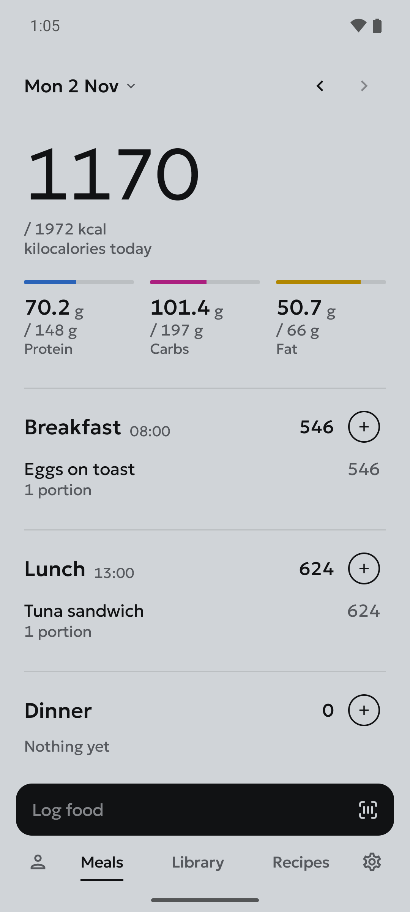
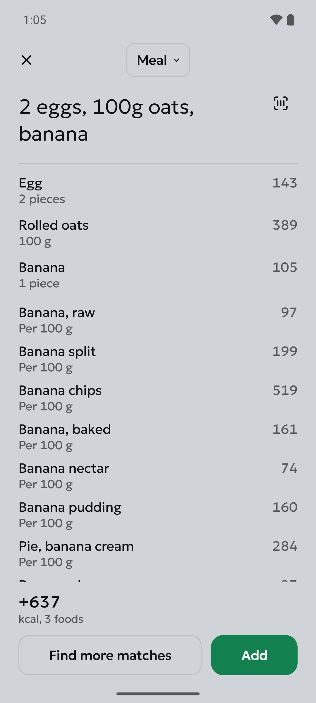
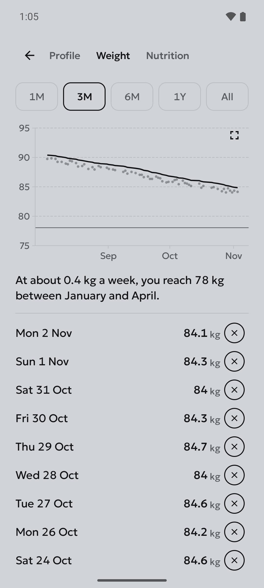
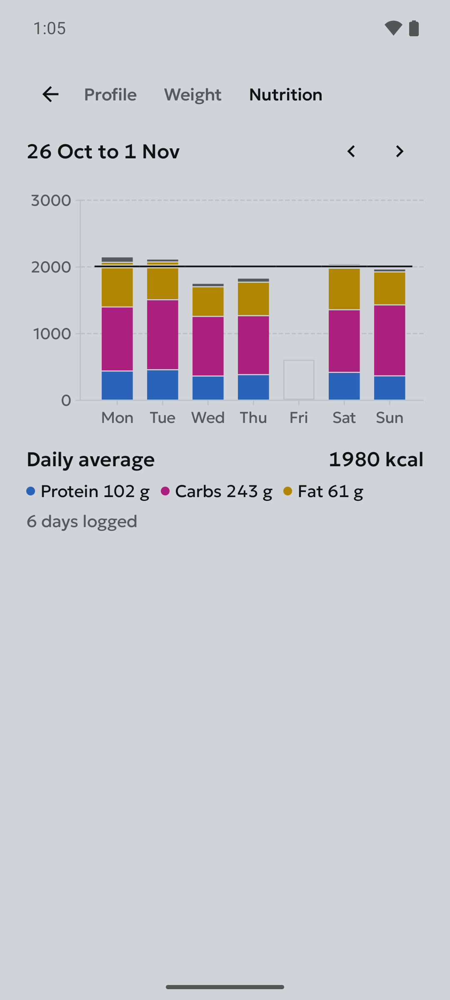
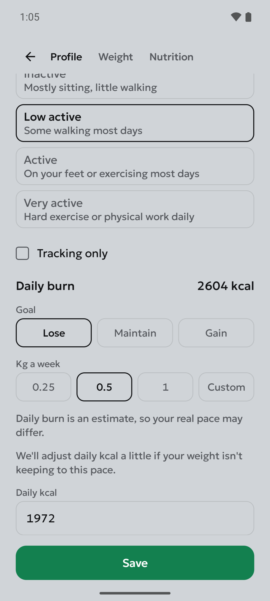

# Breakfast

An Android calorie and macro tracker built around typing what you ate. Enter `2 tbsp oats, half a tbsp peanut butter, banana` and the app works out the portions, finds the foods and logs them.

It works offline and keeps your diary on your phone. There is no account and no cloud sync.

<p>
  
  
  
  
  
</p>

The screenshots use made-up sample data.

## Features

- **Natural logging:** several foods in one line, with amounts in grams, millilitres, servings or words like "half a tbsp".
- **Ranking that learns:** foods you pick often and recently come first.
- **Built-in foods:** a bundled USDA database that works with no connection.
- **Barcodes and Open Food Facts:** scan a product or search for it, and contribute corrections if you want to.
- **Recipes and personal foods:** save your own, with custom servings and aliases.
- **Diary:** Breakfast, Lunch, Dinner and Snacks for each day. Editing a food later never rewrites what you already logged.
- **Daily burn and goals:** an estimate from your details, adjusted over time by your logging and weigh-ins, with a pace to lose, maintain or gain and macro targets in percent or grams.
- **Weight and nutrition:** a weight chart with a trend line and a projected date range, and weekly macro bars against your goal.
- **Tracking only:** a mode with no targets or weights.
- **Colour-blind options:** macro colours for protanopia, deuteranopia and tritanopia, or monochrome.
- **Export and import:** your whole diary as one file.

Latin and Cyrillic food names both work, and their searches stay separate.

## Build

You need JDK 21 and the Android SDK (API 37). Android 8.0 (API 26) is the minimum.

```sh
git config core.hooksPath .githooks
./gradlew testDebugUnitTest assembleDebug
```

The APK lands in `app/build/outputs/apk/debug/`. Install it with `adb install -r`, which keeps your data.

`assemblePerf` builds a minified version signed with the debug key, for trying out real speed. There is no release signing setup in this repository.

Device tests are in `app/src/androidTest`. Don't run `connectedDebugAndroidTest` on a phone with a diary you care about, because it uninstalls the app afterwards and takes the data with it. [`docs/architecture.md`](docs/architecture.md) has the safe way to run them, and explains how the app is put together.

The USDA database (FNDDS 2021-2023, plus the raw and home-cooking foods of SR Legacy 2018-04) is rebuilt with `tools/build_usda_catalogue.py`, as described in [`docs/usda-catalogue-spec.md`](docs/usda-catalogue-spec.md).

## Licence

Copyright (c) 2026 Marino Jakmoski ([marin-o](https://github.com/marin-o)).

Breakfast is free software under the [GNU General Public License, version 3](LICENSE). You can use, change and share it, and you can even sell it, but anything you distribute based on it has to be released under the same licence, with its source code.

## Credits

The ranking idea comes from [zoxide](https://github.com/ajeetdsouza/zoxide), which ranks directories by how often and how recently you visit them. Breakfast applies the same idea to foods, with its own formula and no zoxide code.

Food data comes from [USDA FoodData Central](https://fdc.nal.usda.gov/) and [Open Food Facts](https://world.openfoodfacts.org/). Full credits and third-party licences are in [NOTICE](NOTICE).
