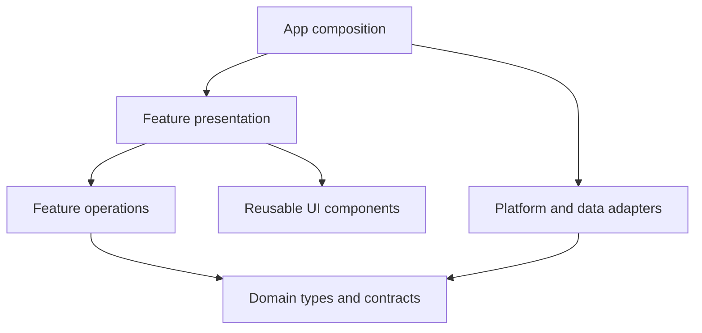
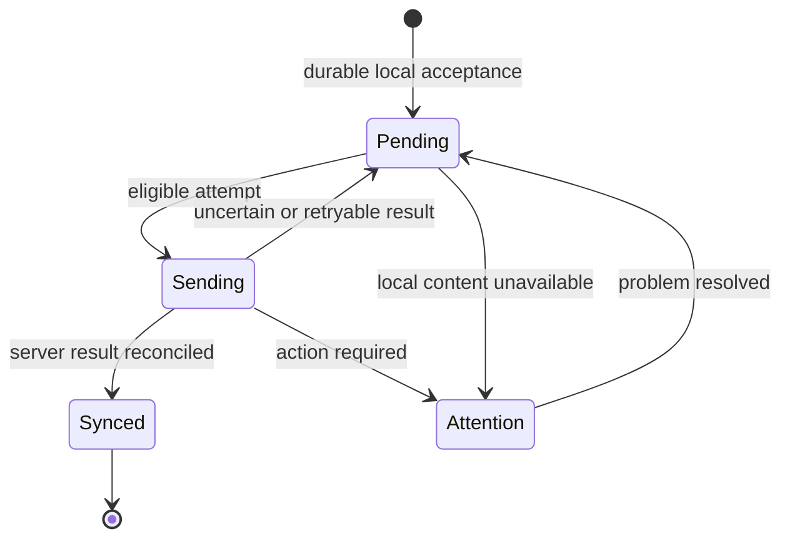

# Building Mobile Apps That Are Easy to Understand, Maintain, and Extend

**A researched practical guide to mobile architecture, code organization, UI/UX, lifecycle, data, accessibility, testing, security, performance, and delivery**

Research date: **25 October 2026**

## How to use this guide

The central recommendation is to **make ownership, lifetime, and failure behavior explicit**. A maintainer should be able to discover who owns a value, how long it survives, which operation changes it, what happens when that operation is interrupted, and how to verify the result.

This is a mobile-specific companion to the general maintainable-software guide. It focuses on Android and iOS/iPadOS applications, including native and cross-platform implementations. Examples assume an ordinary application maintained by an individual or a small team. Games, medical devices, intensive media processing, and other specialized products need additional domain-specific engineering.

**Source policy.** The sources are original platform and language documentation; standards and security projects; original writings by established engineers; university-hosted research; and original papers on local-first software and mobile permission failures. Content aggregators and anonymous “best practices” lists are excluded. Platform documentation is authoritative about its APIs and platform expectations, but its architectural preferences are not proof that one design is best for every application.

The recommendations, sample folder layout, decision tables, and feature walkthrough are **a synthesis**, rather than an official architecture prescribed by Apple, Google, or any framework. Source notes distinguish platform guidance, standards, research arguments, and practitioner judgment. Books are recommended from verified author information and relevant material, without claiming that every book was freshly read in full for this report.

**Version caution.** Mobile platforms change quickly. Use the supported APIs and documentation for your actual deployment targets, SDKs, and dependency versions. The guide emphasizes durable decisions; examples of current APIs are not a requirement to upgrade an existing app immediately.

**Reading routes:** For a new app, start with Sections 1–4 and the adoption plan in Section 16. For an app that loses work or behaves unpredictably, start with Sections 5–8. For interface work, read Sections 9–10. For an existing team or codebase, use Sections 12–16 to prioritize improvements.

## Contents

1. [The most useful mobile defaults](#1-the-most-useful-mobile-defaults)
2. [Choose platforms and a stack deliberately](#2-choose-platforms-and-a-stack-deliberately)
3. [Choose architecture and patterns by responsibility](#3-choose-architecture-and-patterns-by-responsibility)
4. [Organize the codebase for navigation and change](#4-organize-the-codebase-for-navigation-and-change)
5. [Write clear code and make concurrency explicit](#5-write-clear-code-and-make-concurrency-explicit)
6. [Design state ownership and lifecycle together](#6-design-state-ownership-and-lifecycle-together)
7. [Treat offline data and synchronization as product behavior](#7-treat-offline-data-and-synchronization-as-product-behavior)
8. [Make navigation and background work reliable](#8-make-navigation-and-background-work-reliable)
9. [Design complete mobile experiences](#9-design-complete-mobile-experiences)
10. [Build accessibility and adaptation into the interface](#10-build-accessibility-and-adaptation-into-the-interface)
11. [Make security and privacy part of the architecture](#11-make-security-and-privacy-part-of-the-architecture)
12. [Test behavior across mobile failure conditions](#12-test-behavior-across-mobile-failure-conditions)
13. [Measure performance and resource use](#13-measure-performance-and-resource-use)
14. [Release safely to an installed client population](#14-release-safely-to-an-installed-client-population)
15. [Make the app easy to walk through and extend](#15-make-the-app-easy-to-walk-through-and-extend)
16. [Apply the guidance without overengineering](#16-apply-the-guidance-without-overengineering)
17. [Learning path and annotated sources](#17-learning-path-and-annotated-sources)

## 1. The most useful mobile defaults

Mobile architecture has to account for interruptions and constraints that a continuously running development session can hide. Android and Apple document process, scene, and background lifecycles that limit what an app can assume about continued execution. Treat those lifecycles as design inputs. [A4] [I3] [I4] [I7]

| Area | Useful default | Maintenance benefit |
| --- | --- | --- |
| Product definition | Describe a complete task, including interruption and recovery. | Requirements expose data and lifecycle obligations early. |
| Architecture | Separate presentation from data access; add further boundaries where they simplify change. | Screen code does not become the owner of every concern. |
| State | Give each piece of state an owner and a documented lifetime. | Restoration and account changes become predictable. |
| User work | Persist meaningful drafts and accepted local changes at appropriate checkpoints. | Recovery does not depend on a final lifecycle callback. |
| Network | Expect slow responses, retries, partial failure, and uncertain outcomes. | Ordinary connectivity problems do not become data corruption. |
| Synchronization | Define what is local, pending, synchronized, conflicted, or rejected. | Users and maintainers can understand incomplete operations. |
| UI | Prefer familiar platform interactions and reusable semantic components. | People can transfer existing knowledge; fixes propagate consistently. |
| Accessibility | Design for assistive technology, larger text, and varied input from the start. | Core tasks remain usable as the interface evolves. |
| Concurrency | Make execution context, cancellation, and stale-result handling visible. | Async work is easier to reason about and test. |
| Security | Treat the installed app as an untrusted client of protected server resources. | Authorization does not depend on hiding a button or a secret in the binary. |
| Quality | Combine fast logic tests with device, lifecycle, and integration checks. | Tests cover the boundaries that make mobile behavior distinctive. |
| Delivery | Plan for multiple app versions to coexist. | A backend or schema change does not strand installed clients. |
| Documentation | Maintain a quick start, feature map, state model, and release procedure. | A new maintainer can follow a real feature end to end. |

These defaults are a project agreement to adapt, not a requirement for a particular number of layers, classes, tests, or tools.

### Turn quality goals into scenarios

Use concrete examples before choosing an architecture:

- A person writes a note, switches apps, and returns after the operating system has reclaimed the process. The saved draft is recoverable.
- A person submits an attachment, the connection drops after the server accepts it, and the app retries. The server does not create an unintended duplicate.
- A person opens a notification while signed out. After authentication, the app validates access and opens the intended item or explains why it is unavailable.
- A person enlarges text and uses a screen reader. They can still identify fields, submit the form, understand an error, and recover.
- An installed older client continues to operate during a backend deployment within the product's documented compatibility policy.

These are illustrative acceptance criteria. The product must decide what it promises; for example, an online-only purchase may require connectivity, while a note draft should usually remain editable locally.

## 2. Choose platforms and a stack deliberately

### 2.1 Make the expensive constraints visible

Before selecting a framework, record the target operating systems, minimum supported versions, essential hardware and system integrations, expected devices, offline requirements, accessibility needs, and the team's experience. Add any existing code that needs to be maintained or reused.

Prototype the least certain requirement: background transfer, a complex camera workflow, Bluetooth, an accessible custom interaction, a very large list, or integration with an existing native SDK. A simple login screen reveals little about these risks.

### 2.2 Compare implementation approaches by the work they create

| Approach | A reasonable fit when | Work to account for |
| --- | --- | --- |
| Native Android and native iOS | Platform integration, distinct platform experiences, or direct access to platform APIs dominate. | Two implementations and their coordination; shared API contracts and product behavior still need alignment. |
| Flutter | A shared Dart UI and application implementation fits the product and team. | Platform integrations, plugin maintenance, accessibility, and rendering behavior still require validation on each platform. |
| React Native | React/TypeScript expertise and a shared component model fit the team and product. | Native dependencies, platform-specific behavior, runtime boundaries, and upgrades remain part of ownership. |
| Kotlin Multiplatform with native UIs | Sharing models, rules, networking, or persistence is valuable while each platform keeps its own UI. | Shared/native boundaries, exported APIs, concurrency, build integration, and cross-language debugging. |
| Shared UI with Kotlin/Compose Multiplatform | A shared UI is a deliberate product and engineering choice. | Evaluate the supported platform integrations and accessibility behavior against the actual app. |

The technology descriptions follow the projects' own documentation: Flutter provides a shared UI toolkit with platform integration; React Native exposes native components and explicitly supports platform-specific code; Kotlin Multiplatform lets teams choose which code to share. The suitability judgments above are a decision aid, not comparative benchmark results. [X1] [X3] [X4] [X5]

**Code-sharing percentage is not a quality metric.** Shared code is useful when it reduces inconsistent behavior or duplicated maintenance without making platform differences obscure. A small explicit platform adapter can be easier to maintain than a large abstraction filled with operating-system checks.

An existing, understandable UIKit, Android Views, or other established implementation does not need a wholesale rewrite merely because a newer UI framework exists. Modernize where a concrete maintenance, product, or support need justifies it. Preserve behavior with focused checks while changing one boundary at a time.

### 2.3 Keep platform conventions even when code is shared

Separate **shared product meaning** from **platform presentation**. “Delete this draft” should have consistent semantics everywhere; Back behavior, permission dialogs, text selection, system sharing, and navigation presentation should respect the platform.

Evaluate dependencies by supported platforms, maintenance activity, licenses, transitive dependencies, privacy behavior, upgrade history, and an exit strategy. A plugin that wraps a critical OS feature is part of the app's architecture, not incidental glue.

## 3. Choose architecture and patterns by responsibility

### 3.1 Start with a few understandable responsibilities

For a typical app, begin with:

1. **Presentation:** screens, reusable visual components, and UI-specific state and behavior.
2. **Application operations:** named actions such as creating a draft or submitting an attachment, extracted when orchestration is substantial or reused.
3. **Data ownership:** repositories or equivalent boundaries that coordinate authoritative reads, writes, caching, and synchronization policy.
4. **Adapters:** implementations for HTTP, storage, files, secure storage, and operating-system services.

These are responsibilities, not necessarily four build modules or one class per responsibility. A small app can express them in a small number of cohesive files.

Android recommends UI and data layers, with an optional domain/use-case layer when complexity or reuse warrants it. Flutter's official guide likewise makes its domain layer conditional. Neither recommendation requires every button press to pass through a ceremonial chain of forwarding classes. Android's use of “domain layer” is also not identical to the term in every version of Clean Architecture. [A1] [A2] [X2]

On iOS, SwiftUI defines tools for state ownership, observation, and data flow; those tools do not require a particular application-wide folder structure or an obligatory view-model class for every view. Choose boundaries for the behavior being implemented. [I1] [I2]

### 3.2 Hide decisions that are likely to change

Parnas's modularity argument is about separating changeable design decisions so that one part can be understood and modified with limited knowledge of the rest. In a mobile app, examples include the storage format, media-upload protocol, authentication integration, or notification implementation. [F3]

A useful boundary exposes meaningful operations: `saveDraft`, `observeNotes`, `queueAttachment`. A wrapper that merely renames every database method may leave storage details exposed while adding navigation overhead.

Keep the public surface small enough to explain, but substantial enough to hide real complexity. “Many tiny classes” and “one enormous manager” can both make a feature difficult to follow. Ousterhout's discussion of complexity and module design is useful background for assessing this tradeoff. [F4]

### 3.3 Use pattern names to clarify a design

| Pattern or technique | Problem it can solve | Misuse to avoid |
| --- | --- | --- |
| Presentation Model / MVVM | Makes presentation behavior inspectable independently of UI controls. | A view model that becomes a global session, networking, navigation, and storage manager. |
| Unidirectional data flow | Makes events, state transitions, and rendering direction predictable. | Requiring a global event bus or reducer framework for every local toggle. |
| State machine | Makes valid states and transitions explicit for uploads, authentication, or multi-step forms. | Encoding the same operation with unrelated booleans that permit contradictions. |
| Repository | Gives callers a coherent data boundary and ownership policy. | Several competing repositories that each claim authority over the same entity. |
| Dependency injection | Makes dependencies and test substitutions visible. | Hidden service lookup throughout the code, or a container that is more complex than the object graph. |
| Adapter | Contains platform, service, or storage-specific translation. | Recreating an entire vendor API behind a speculative abstraction. |
| Strategy | Separates a real variation, such as distinct conflict policies. | Building a plugin system for variations that have no demonstrated use. |
| Durable work queue / outbox | Retains intent across interruptions and coordinates eventual delivery. | Assuming a queue alone provides exactly-once server effects. |
| Observation / subscription | Propagates changes to consumers. | Subscriptions with unclear ownership, lifetime, ordering, or cleanup. |

The table combines established presentation and injection patterns with mobile state/data guidance and this guide's application examples. MVVM and unidirectional flow can coexist: one describes roles; the other describes how changes move. “MVI” has varying implementations, so document the actual event/state/effect contract instead of relying on the acronym. [F5] [F7] [A1] [A3]

### 3.4 Apply familiar principles as questions

**Single responsibility:** Which changes should this unit own? A screen can own layout while a repository owns persistence policy. The rule does not mean one method per class.

**Dependency inversion:** Which details should core rules avoid knowing? Pass a clock, attachment store, or authenticated API capability where it makes behavior clearer and testable. Manual constructor or initializer injection is often sufficient. [F5]

**DRY:** Are two places independently encoding the same rule? Consolidate the rule, such as allowed attachment types. Similar layouts with different product semantics may reasonably remain separate.

**KISS and YAGNI:** What is the simplest design that satisfies the known requirements? Simplicity must include failure handling and data integrity. Removing an essential transaction or recovery path makes the code shorter without making the product simpler to maintain.

**Composition:** Prefer combining focused behavior over creating deep hierarchies of base screens, base view models, and base repositories. Use framework-required inheritance where it belongs; avoid making unrelated features depend on a growing collection of protected hooks.

## 4. Organize the codebase for navigation and change

### 4.1 Make feature locations predictable

For a growing app, a feature-oriented layout with explicit shared infrastructure is a useful starting point. This is an illustrative logical map, not a mandatory physical directory tree.

| Logical location | Contents | Boundary rule |
| --- | --- | --- |
| `app/` | Entry points, composition, top-level navigation, environment configuration. | Assembles dependencies; does not accumulate every business rule. |
| `features/notes/` | Note screens, presentation state, feature operations, focused tests. | Uses documented data and platform boundaries. |
| `features/settings/` | Settings presentation and operations. | Does not read another feature's internal screen state. |
| `data/notes/` | Note repository, persistence mapping, sync policy. | Owns the note data contract. |
| `platform/` | OS-specific scheduling, secure storage, sharing, media access. | Exposes narrow capabilities appropriate to their callers. |
| `design/` | Semantic tokens and genuinely reusable UI components. | Avoids application data access and feature-specific business rules. |
| `testing/` | Shared fixtures, realistic fakes, test utilities with clear purposes. | Does not become a second production framework. |
| `docs/` | Quick start, architecture map, decisions, feature walkthrough, release notes. | Explains the running code and its operational assumptions. |

Use platform-native resource locations and build conventions. An Android feature's resources and source sets, an iOS target's resources and tests, and Flutter or React Native asset structures should remain recognizable to their toolchains.

For a very small app, `App`, `Notes`, `Data`, and `Tests` may be enough. Extract shared components when their reuse and contract are clear. A directory named `common`, `core`, `helpers`, or `utils` should not become an unowned destination for unrelated code. Kotlin's own conventions encourage descriptive files and keeping related declarations together. [F2]

### 4.2 Distinguish folders from enforceable modules

Folders and package names improve discoverability. Build modules or targets, language visibility rules, and dependency checks can enforce separation. In Kotlin, `internal` is module-wide; a package name alone is not an access boundary. Add enforcement where its value exceeds the added build and configuration work. [F8]

Android's modularization guidance describes benefits such as encapsulation and reuse, but also warns about excessive granularity. A new Gradle module for every small UI element can increase coordination and build maintenance without creating a useful boundary. Apply the same cost-benefit question to Swift packages and other build systems. [A7]

Good reasons to extract a module include independently testable complex logic, reuse across apps or extensions, enforced ownership, or a measured build bottleneck. “The architecture diagram needs another box” is not a reason.

### 4.3 Document dependency direction

The following shows one possible **static dependency structure**, not runtime call order. Interfaces can sit with their consumers when dependency inversion is useful.

In a smaller app, presentation can call a repository directly and omit the separate operations layer. The important questions are whether dependencies form understandable boundaries and whether a feature can change without importing unrelated implementation details.

Keep navigation integration at a defined boundary. A notes feature should not need to instantiate the internals of the account feature merely to request authentication. Likewise, a design-system button should not know how to upload a note.

## 5. Write clear code and make concurrency explicit

### 5.1 Prefer meaningful names and explicit contracts

Use names that explain domain meaning, units, or side effects: `draftId`, `uploadAttemptId`, `retryDelay`, `saveLocally`, `requestNotificationAuthorization`. Follow the language's usual conventions and automate formatting. Swift's API guidance prioritizes clarity where an API is used; Kotlin provides consistent naming and organization conventions. [F1] [F2]

Document the parts that a signature cannot communicate: whether an operation persists before returning, whether it can be retried, whether cancellation changes the outcome, and whether a returned value may be stale.

Model domain distinctions explicitly. A local note ID and server note ID are not automatically interchangeable. A calendar date and an instant are different concepts. A local path, a temporary photo-picker reference, and a persistent attachment identifier have different lifetimes.

Prefer types and constructors that prevent invalid values, then validate external data at boundaries. Typed decoding does not establish all domain invariants. Validate ranges and cross-field consistency, and define how unknown enum cases from newer servers are rejected or mapped. Avoid force unwraps and unchecked casts as a substitute for defining failure behavior.

### 5.2 Keep pure decisions separate from effects

Validation, formatting decisions, conflict policy, and state transitions are easier to test when they take explicit inputs and return outputs. Keep network calls, file access, permissions, and scheduling at identifiable edges.

For example, `canSubmitDraft(draft, limits)` should not secretly read a singleton account manager and make a network request. Pass the relevant facts. Keep the authoritative server check as well where access or shared data integrity depends on it.

Prefer immutable snapshots for data crossing boundaries, while keeping mutable state under a clear owner. A read-only reference does not automatically make every nested object immutable; be precise about what can change.

Declarative rendering can run repeatedly. Avoid starting network requests or registering external listeners directly in rendering code. Use APIs with deliberate lifetimes and cleanup. Compose's effect APIs make restart keys and disposal explicit; choosing those keys is part of the behavior, not incidental syntax. [A16]

### 5.3 Async work needs a lifetime and an execution context

Both platforms provide structured concurrency tools, but declaring a function asynchronous does not by itself move expensive synchronous work off the UI execution context. Android's coroutine guidance calls for main-safe suspend functions and appropriate dispatchers; Swift's concurrency guidance requires attention to actor isolation and execution behavior. Record the Swift language mode, concurrency-checking configuration, and default actor-isolation settings per target: behavior depends on the toolchain and enabled features. [A8] [I6]

For every operation, answer:

- Who starts it, owns it, and cancels it?
- Should it end with its UI owner, continue within a longer-lived application or navigation scope, or remain scheduled across process termination?
- Which context performs CPU-intensive or blocking work?
- What happens if two invocations overlap?
- Can a result arrive after the relevant account, item, or query changes?

Search is a useful example: an old request can finish after a newer one. Cancellation can reduce wasted work, while a query revision or request identity prevents an obsolete response from replacing the current result. Cancellation alone is not a complete stale-result policy.

Do not swallow cancellation as an ordinary failure. Kotlin's guidance explicitly calls for preserving `CancellationException`; Swift task cancellation is cooperative, so code must use APIs or checks that respond to it. Conversely, canceling a client task does not prove that a remote write never happened. [A8] [I10]

### 5.4 Serialization does not remove every race

An actor or serialized state holder can prevent unsynchronized access to its state, yet assumptions made before an `await` can become outdated before execution resumes. Recheck account identity, record revision, or operation ownership before applying the result. Swift's actor model explicitly permits this form of interleaving at suspension points. [I11]

Prevent duplicate submissions in the UI when appropriate, but enforce duplicate protection and authorization at the data/server boundary. A second entry point, a retry, or a restarted process can bypass a disabled button.

## 6. Design state ownership and lifecycle together

### 6.1 Classify state by the promise it must keep

| State | Example | Appropriate lifetime and approach |
| --- | --- | --- |
| Transient interaction | Pressed state, an animation, a temporary focus highlight. | Usually local to the relevant view or component. |
| Restorable presentation | Selected tab, item ID, search query, scroll position. | Small restoration data, if returning to that context is useful. |
| Meaningful user work | A note draft, unsent form, pending attachment. | Durable app storage according to an explicit save/recovery policy. |
| Business records | Saved notes, account-scoped settings, server revisions. | Owned by the data layer with defined persistence and synchronization. |
| Durable operation intent | An accepted upload waiting for connectivity. | Persistent work record with retry and reconciliation rules. |
| Credentials and keys | Session credentials, encryption keys. | Platform security facilities and a documented credential lifecycle. |

This classification is a design aid. Restoring a screen and preserving the user's work are different requirements.

### 6.2 Android: configuration changes are not process survival

An Android `ViewModel` can retain in-memory state across supported configuration changes, but does not survive process death. Saved-state mechanisms such as `SavedStateHandle` and Compose's supported saveable-state APIs can retain small reconstruction values under their documented conditions. They are not a database for substantial user data. Store durable data separately and reconstruct the screen from identifiers and saved inputs. [A4]

Keep UI collection lifecycle-aware so a screen's observation matches its intended visibility and lifetime. Avoid keeping an Activity or view alive through a long-lived state holder. Use the current lifecycle and state APIs appropriate to the app's UI stack. [A1] [A3]

Test configuration recreation, background process loss, and user-initiated force stop as distinct conditions. Their behavior and restoration guarantees are not interchangeable.

### 6.3 iOS: view identity, scene restoration, and persistence differ

SwiftUI state belongs to the lifetime and identity of the relevant view or model. Observation connects models to presentation; it does not provide durable storage. SwiftUI's Observation integration is available from iOS 17, so apps supporting earlier versions need appropriate compatible mechanisms. [I1] [I2]

`SceneStorage` is intended for scene restoration. Apple does not guarantee exactly when it is persisted, and it is unsuitable for sensitive data or the only copy of important work. Multiple scenes also mean that a single global “current screen” or “current draft” may be the wrong model. [I3]

Treat scene activity changes as signals to coordinate behavior, not a reliable final opportunity to save everything. Choose a durable store and checkpoint policy that match the product's promise. [I4]

### 6.4 Represent real states, including partial success

Avoid a cluster such as `isLoading`, `hasError`, `isSaved`, and `isUploading` when combinations can contradict one another. Use an enum, sealed hierarchy, or otherwise explicit state model for mutually exclusive phases. Keep independent concerns separate: usable cached content can coexist with a failed refresh.

For a note, distinguish **saved on this device**, **waiting to sync**, **syncing**, **synced**, and **needs attention**. Do not label a local commit as a completed cloud backup. State names should reflect the guarantee the system has actually achieved.

Store enough context for recovery: the relevant account, operation ID, local record, and last known revision. Derive presentation details such as a spinner from that state where possible, rather than maintaining parallel sources of truth.

### 6.5 Be precise about events and one-time effects

A “show success” event can disappear while a screen is absent, or replay unexpectedly after recreation, depending on its delivery mechanism. Decide whether the outcome is durable state, a transient effect, or a navigation action with an identity.

For a completed save, durable data should establish success even if a toast is missed. For navigation, define whether repeated delivery opens one destination or creates duplicate stack entries. For payments and other consequential work, rely on operation status and reconciliation, not on a one-time UI event. Android's UI-event guidance discusses the delivery problem when producers outlive consumers. [A14]

## 7. Treat offline data and synchronization as product behavior

### 7.1 Decide what works without connectivity

“Offline support” can mean several different promises:

| Capability | Example | Required behavior |
| --- | --- | --- |
| Offline reading | Read previously downloaded notes. | Explain unavailable content and relevant freshness limits. |
| Local drafting | Write a note without signing in or reaching a server. | Preserve the draft and define later account association. |
| Queued changes | Add an attachment now and upload later. | Retain work durably and expose meaningful pending/failure states. |
| Multi-device editing | Edit the same record on two disconnected devices. | Define conflicts and reconciliation rather than silently overwriting work. |
| Online-only operation | Confirm a purchase or reserve scarce inventory. | Require server confirmation and distinguish an uncertain outcome from rejection. |

For an offline-first repository, Android recommends that application reads come from a local source that synchronization updates. That is a useful implementation approach, not a claim that every operation can be performed offline. A local read model also does not supersede server authority over access, shared inventory, or other protected decisions. [A5] [A11]

Kleppmann, Wiggins, van Hardenberg, and McGranaghan's *Local-first software* develops the broader argument for offline capability, user ownership, and collaboration. It is a research/design paper with prototypes and tradeoff analysis, not evidence that every mobile app should implement CRDTs or eliminate its server. [D1]

### 7.2 Define the data contract before the retry loop

For each synchronized entity, write down:

- Its stable identity and account or workspace ownership.
- Which values are authoritative locally and which require server acceptance.
- How creates, updates, and deletions are represented.
- How revisions are compared and conflicts are recognized.
- How duplicate attempts are identified.
- How pending work survives restart, logout, and schema changes.
- When local data may be evicted, exported, or permanently deleted.

Choose the simplest conflict policy that preserves the product's intended meaning. Rejecting a stale update and asking the person to review it may be appropriate. Field-specific merging may suit another case. Last-write-wins can be acceptable for some preferences, but silently discarding a paragraph of authored text is a different product decision. Do not rely on device wall clocks as universally trustworthy conflict ordering.

HTTP provides useful building blocks: conditional requests such as `If-Match` can protect against overwriting a changed representation. These mechanisms still need an application-level policy for explaining and resolving a conflict. [D2]

### 7.3 Make retries safe and bounded

A timeout does not establish that the server rejected a write. The server may have accepted it before the response was lost. Retrying an operation therefore needs idempotent semantics or an explicit way to determine whether it already took effect. HTTP's standard distinguishes idempotent methods and warns against automatically retrying non-idempotent requests without such knowledge. [D2]

For a queued create, a practical design is a stable operation ID, a server-side deduplication contract, and a way to retrieve the accepted result. Specify the scope, retention, and payload-matching rules for the operation ID. Sending a header named “idempotency key” does nothing unless the server implements the corresponding behavior.

Apply bounded retries with backoff and appropriate jitter; avoid retrying validation failures or denied authorization as though connectivity would fix them. Treat authentication expiry, rate limits, conflicts, permanent failures, and temporary transport failures differently. A connectivity indicator can help schedule attempts, but a reported connection does not prove the desired service is reachable.

Give users useful recovery actions. “Retry,” “Edit,” “Sign in again,” and “Remove pending upload” represent different remedies. Preserve the original content while recovery remains possible.

### 7.4 Persist intent and reconcile after interruption

When the product promises to retain an accepted offline change, commit the local change and its pending synchronization intent together where possible. A database transaction can couple related records; a database update and an arbitrary file copy are not automatically one atomic operation.

For file attachments, use an explicit staging and cleanup policy. Make sure a queued record refers to durable, readable content before claiming it is ready. On restart, reconcile unfinished imports, missing files, abandoned temporary files, and work that was in progress when the process ended.

This simplified diagram describes a **durable synchronization record** for an illustrative upload. A production design also needs scheduling, concurrent-worker ownership, cancellation rules, and server reconciliation.

“Sending” is not proof that a transfer is still running after restart. Reconcile its operation ID and any platform transfer state before retrying. Duplicate delivery can be normal; duplicate business effects must be controlled deliberately.

### 7.5 Choose storage for its role and test upgrades

Preferences, restoration state, disposable caches, structured records, large files, and secrets have different requirements. Android's DataStore guidance distinguishes small datasets from cases needing a database such as Room. On iOS, SwiftData or Core Data can support appropriate structured persistence; SwiftData availability and migration support must match the deployment target. No storage framework independently designs synchronization. [A13] [I9]

Treat database migrations as user-data preservation work. Room's documentation explicitly distinguishes schema validation from checking that transformed data is correct. SwiftData exposes versioned migration planning for changes that need it. Keep representative old stores and test supported upgrade paths, including pending work. Destructive reset is appropriate only for data the product can legitimately discard or reconstruct. [A12] [I12]

Do not promise logout, account deletion, backup, or export behavior without specifying which copies and pending operations it affects. In particular, queued work must remain associated with the account that created it; signing into a different account must not silently redirect that work.

## 8. Make navigation and background work reliable

### 8.1 Treat routes as a contract

Use meaningful destinations with minimal stable arguments, such as a note ID. Resolve the current record through the normal data boundary. Passing a large mutable object through navigation can create stale copies and complicate restoration.

Specify normal navigation, Back behavior, modal dismissal, deep links, notification entry, and restoration together. A restored route may reference a deleted item or an expired account. Show a comprehensible fallback and preserve any recoverable work.

Current Android navigation guidance includes application-owned and saveable back stacks. On iOS, a `NavigationPath` can represent navigation state, but serializing it requires every element to be `Codable`, beyond the `Hashable` requirement for storing elements. The app must still decide which routes are appropriate to restore. [A9] [I5]

### 8.2 Deep links are another entry point into the same application

Use one understandable route-resolution policy for links and ordinary navigation. Validate incoming paths and parameters, establish the intended account, load the resource, and enforce normal authorization. Apple explicitly calls for validating universal-link parameters; OWASP treats platform entry points as security boundaries. [I13] [Q12]

Test a link when the app is stopped, already displaying another item, signed out, signed into a different account, offline, or unable to access the resource. A verified domain association identifies which app may handle a link; it does not authorize the linked action.

Avoid performing destructive actions solely because an external URL was opened. Make consequential actions explicit and checkable within the application's normal rules.

### 8.3 Use the background mechanism appropriate to the job

| Need | Android direction | iOS direction |
| --- | --- | --- |
| Short work belonging to a visible screen | An owned coroutine/task with an appropriate lifecycle. | A view/model-owned task with an appropriate lifecycle. |
| Eligible deferrable work that must remain scheduled | WorkManager with appropriate constraints and recovery. | Relevant BackgroundTasks API, with durable intent and expiration handling. |
| Qualifying long transfer | Choose the supported transfer/background mechanism for the use case and OS restrictions. | Background `URLSession` for supported transfers, with session/event handling. |
| Time-critical alarm, continuous activity, or specialized system integration | Follow the specific platform API and eligibility rules. | Follow the relevant background mode or specialized API; a generic timer is insufficient. |

WorkManager is designed for persistent scheduled work; it does not guarantee exact periodic execution. iOS background scheduling is likewise controlled by the operating system. Persisted work can remain pending even when the app would prefer it to run immediately. [A6] [A15] [I7]

On iOS, background `URLSession` transfers differ from ordinary in-process requests. Apple's documentation distinguishes normal system termination from a user force-quit, which cancels those transfers and prevents automatic relaunch until the user relaunches the app. Do not promise uninterrupted transfer under every termination condition. [I8]

Finish promptly, honor expiration/cancellation, and reconcile partial progress. An in-process application scope can outlive a screen; it still cannot outlive the process by itself.

### 8.4 Make notifications useful and nonessential to data correctness

Define the notification's purpose, permission flow, destination, privacy-sensitive content, and behavior when its referenced item is gone. Give people suitable controls over categories and frequency.

For this guide's notes example, a “upload complete” notification is an optional convenience. The authoritative completion status must also be visible when the app opens. The product should remain understandable if the person denies notifications or never opens a particular notification.

Treat notification payloads and actions as inputs to validate. Avoid exposing sensitive note content on a lock screen by default when the product's privacy model calls for discretion. [U3] [Q12]

## 9. Design complete mobile experiences

### 9.1 Begin with tasks and information hierarchy

Describe what the person wants to accomplish and the conditions in which they will do it. Mobile use can involve interruption, one-handed interaction, motion, glare, noise, or a limited connection. These are scenarios to investigate with the intended audience, not assumptions that apply to every person at all times.

For each important screen, identify the primary task, the information required to make a decision, the next action, and the route back. Prefer familiar concepts and labels. Establish visual hierarchy through spacing, grouping, type, and emphasis; do not require users to decode a wall of equally prominent cards or icons.

Create a small component set for recurring semantics: primary and secondary actions, editable fields, validation messages, empty states, loading indicators, destructive actions, and status labels. A component should include its accessible behavior and state variations, not only its colors.

### 9.2 Design the whole state space

| Situation | A useful design question |
| --- | --- |
| First use | Can someone reach useful content with the minimum necessary setup? |
| Loading | What is happening, and can the person continue another task? |
| Empty | Is there no data yet, no search match, no access, or no downloaded content? |
| Partial/stale content | Which content is usable, and what freshness limitation matters? |
| Validation error | What specifically needs correction, and is the input preserved? |
| Network failure | Is retry appropriate, and is any outcome uncertain? |
| Permission denied | What remains possible, and is there an alternative? |
| Success | What has actually completed: local save, submission, or server confirmation? |
| Interruption | What survives a call, backgrounding, rotation, or process recreation? |
| Destructive action | Can the person recover, and what are the consequences? |

These states should be designed alongside the happy path. Reusable previews and fixtures make them reviewable without relying on a particular live backend response.

Preserve valid input after errors. Put specific guidance near the relevant field, and provide an error summary or announcement when needed for orientation. Do not obscure the problem beneath a toast that disappears before it can be understood.

### 9.3 Keep navigation recognizable

Use stable destinations for navigation and distinguish them from actions. Apple's HIG describes tab bars as navigation among sections and recommends modality for focused tasks with clear dismissal. Account for gesture dismissal as well as explicit buttons when work could be lost. [U16] [U17]

Respect Android's system Back behavior and the navigation behavior supported by the chosen platform toolkit. Avoid trapping people in a flow or overriding a familiar gesture for an unrelated action. When a layout changes from a stack to multiple panes, preserve the person's selection and understanding of where they are.

Use gestures as useful accelerators, with discoverable alternatives for important actions. An unexplained swipe should not be the only way to complete a core task. Confirmations are useful when consequences warrant them; undo can reduce friction where reversal is actually reliable.

### 9.4 Ask for setup and access at the useful moment

Apple's onboarding guidance recommends postponing nonessential setup and allowing people to reach the experience quickly. Request access when its purpose is apparent, and make the explanation specific to the feature. [U5] [U3]

For “Attach a photo,” prefer a system picker where selection is sufficient. Apple PhotosUI and Android's photo picker allow the person to share selected media without granting broad access to the whole library. A full photo-management application may need different access. Handle canceled selection and unavailable or slow-to-load assets. [U6] [U7]

Permission denial is a supported state. Android's runtime-permission guidance calls for contextual requests and graceful degradation. Recheck access when needed because a previous grant is not a permanent promise. Avoid repeatedly pressuring a person to enable a capability unrelated to their current task. [U4]

### 9.5 Validate with actual task performance

Use prototypes or working builds to observe likely users attempting realistic tasks. Ask them to find and complete the task without naming the control they should press. Include people using assistive technology and the devices or conditions relevant to the product. GOV.UK's moderated-testing guidance is a useful practical method. [U9]

For the sample app, test “Add a photo to this note and make sure you can find it later” and “Explain whether this note is available on your other device.” Observe confusion about local save versus sync rather than only asking whether the screen looks attractive.

Iterate on observed obstacles. A fixed small participant count is not a guarantee of sufficient coverage; the right research depends on task diversity, audience diversity, and the risk of missing a problem.

## 10. Build accessibility and adaptation into the interface

### 10.1 Use the correct platform units and guidance

Android recommends touch targets of at least **48 × 48 dp** for touch interfaces. As retrieved for this report, Apple's HIG lists **44 × 44 points as the default iOS/iPadOS control size and 28 × 28 points as the minimum**. A comfortable practical default is to aim for 44-point iOS targets with adequate separation, while following the relevant control and context guidance. Do not repeat the common claim that Apple's current universal minimum is 44 points. [U1] [U2]

Points, Android dp, physical pixels, and web CSS pixels are different units. A small visible icon can have a larger interactive area, but neighboring targets must not become ambiguous or overlap in a way that selects the wrong control.

W3C's WCAG2ICT explains how WCAG concepts can apply to non-web software. It is informative guidance, not a separate normative conformance standard. Use it alongside native accessibility APIs and platform guidance; do not blindly transplant web measurements or assume an automated audit proves accessibility. [U8]

### 10.2 Expose meaning to assistive technology

Standard controls provide useful foundations. For custom UI, supply accurate names, roles, values, states, actions, grouping, and traversal order. Decorative images should not create meaningless stops; meaningful images need appropriate descriptions. A visible icon label and an accessibility name solve related but different problems. [U2] [U15]

Verify a complete workflow with VoiceOver and TalkBack: discover the action, enter data, identify errors, understand updates, and recover. Include relevant switch, keyboard, voice, or other input methods where the product depends on them. A chart or custom gesture surface needs an operable alternative when its visual interaction is unavailable.

Keep focus sensible after navigation, dialogs, validation, and content changes. Avoid repeatedly moving accessibility focus during background refreshes. Announce meaningful changes without narrating every low-level update.

### 10.3 Support readable text and adaptable layouts

Use Dynamic Type on Apple platforms and appropriate scalable text on Android. Accommodate larger content with wrapping, growing rows, scrolling, and layout changes. Do not make fixed-height containers the hidden limit on text scaling. Apple's typography guidance covers scaling, including obligations when using custom fonts. [U14]

Check contrast in all supported appearances. Pair color with text, shape, or other meaning where color alone would carry an essential distinction. Respect reduced-motion preferences and provide alternatives when motion conveys information. [U1] [U2]

Design for the **available window**, not only the device's marketing category. Android window-size classes and Apple's adaptive-layout guidance address changing space, safe areas, and related constraints. Test keyboard appearance, split-screen or multiwindow use, folding/resizing where supported, and transitions between layouts. [A10] [U13]

### 10.4 Localize meaning and test expansion

Externalize user-facing strings and use the platform's plural, number, date, currency, and locale-aware formatting facilities. Avoid constructing sentences by concatenating translated fragments. Store canonical domain values separately from localized display strings.

Use leading/trailing layout semantics and check right-to-left presentation. Some directional elements should mirror, while content such as photographs or certain symbols should retain its meaning. Apple's RTL guidance provides the relevant distinctions. Android pseudolocales help expose text expansion, hardcoded strings, and directional problems before translation is complete. [U10] [U11]

Choose date and time semantics deliberately. A due date entered as a calendar day should not unexpectedly shift when the user travels. A scheduled instant, recurring local reminder, and all-day date require different models. Include those distinctions in tests and documentation.

### 10.5 Combine automated checks with human evaluation

Use accessibility inspection and auditing tools to catch repeatable problems, then perform real tasks with assistive technology. Apple explicitly warns that clearing all Accessibility Inspector issues does not guarantee a fully accessible app. Screenshots and component previews are useful evidence of layout, but do not show reading order, focus movement, or operability. [U12]

## 11. Make security and privacy part of the architecture

### 11.1 Establish assets and trust boundaries

Identify the information and capabilities worth protecting: authored content, attachments, identity, session credentials, device permissions, server records, and any financial or sensitive operations. Trace where they cross device storage, the operating system, external apps, SDKs, and remote services.

Use OWASP MASVS to select applicable mobile controls and MASTG to help verify them. MASVS explicitly assumes broader secure-development and threat-modeling work; it cannot guarantee absolute security or substitute for backend protection. [Q7]

The app binary and its local UI cannot be the final authority for a protected server operation. Check authentication, resource ownership, and authorization on the server. An attacker need not follow the normal screen flow, so hiding controls is a usability decision rather than access enforcement. [Q21]

### 11.2 Handle secrets with the right primitive

| Mechanism | What it provides | Important distinction |
| --- | --- | --- |
| Apple Keychain | Protected storage for small secret values with configurable access behavior. | Choose access, synchronization, and lifecycle policies deliberately. |
| Android Keystore | Protection and use of cryptographic keys. | It is not a direct arbitrary-string database for tokens; hardware backing depends on device and configuration. |
| Application database/files | Storage for records and larger content. | Decide separately whether additional encryption and key management are required. |
| Preferences/restoration storage | Small settings or reconstruction data. | Do not treat ordinary preference or restoration mechanisms as secret storage. |

Apple and Android's security documentation describe the different roles of Keychain and Keystore. Avoid tutorials that collapse them into the same API concept. Plan for logout, credential expiry, device restore, lost key access, and deletion. [Q8] [Q9]

Do not embed a shared confidential server credential in a distributed app and assume it remains secret. Public identifiers and intentionally public, restricted client keys are a different case; evaluate their intended capabilities. Obfuscation does not transform a distributed credential into a confidential one. [Q10]

### 11.3 Use the native-app authorization flow correctly

For OAuth public native clients, RFC 8252 specifies an external user agent and PKCE; use the platform's appropriate browser-based authorization facilities and a maintained implementation. RFC 9700 supplies newer OAuth security guidance, including PKCE challenge-method requirements. Do not replace this with an embedded credential-collecting WebView because it is easier to style. [Q10] [Q20]

Validate redirect handling and apply the protocol's protections for the chosen flow. Define token storage, refresh, expiry, logout, and revoked-session behavior. PKCE does not replace server authorization or secure transport, and OAuth authorization alone does not define every application's identity requirements.

### 11.4 Preserve transport security and validate external inputs

Use platform networking with proper TLS validation. Never fix a certificate error by accepting every certificate or hostname. Android's guidance discourages certificate pinning as a general default because certificate changes can strand installed clients. When a specific threat model justifies pinning, design rotation, recovery, and installed-version compatibility explicitly. [Q11]

Validate links, imported files, share inputs, WebView messages, and exposed components. Enforce appropriate size and content limits before expensive processing. Review disclosure through logs, crash reports, notifications, clipboard use, backups, and app-switcher previews according to the data's sensitivity. MASVS-PLATFORM covers platform interaction; MASVS-STORAGE-2 addresses unintended data leakage, including logs and backups. [Q12] [Q22]

### 11.5 Minimize data and own your dependencies

Request the least access that supports the feature; prefer scoped system capabilities when suitable. Document which data leaves the device, for what purpose, and under which user choices. On-device processing can reduce exposure where it meets the product's needs. [U3] [U4]

Analytics, advertising, authentication, and crash SDKs are part of the application. Apple's SDK guidance explicitly retains developer responsibility for included code and its data practices. Review actual SDK behavior, configuration, permissions, startup work, and disclosure requirements. A privacy manifest or signature provides useful information, not proof of complete privacy or security. [Q13]

Keep an inventory of significant dependencies with purpose, owner, version policy, and data access. Remove unnecessary ones, review updates, and maintain a practical response to critical vulnerabilities. Check current store disclosure and submission requirements before release; do not assume an old checklist captures current rules.

## 12. Test behavior across mobile failure conditions

### 12.1 Choose the cheapest test that provides the needed confidence

Android's testing strategy recommends a balance of focused tests and higher-fidelity checks, with adjustment for the app's needs. There is no universal numerical ratio or requirement that every feature have a test in every category. [Q1]

| Test scope | Useful targets | What it does not establish alone |
| --- | --- | --- |
| Pure logic / state transitions | Validation, conflict decisions, retry classification, route parsing. | Real database, OS, or network integration. |
| Component / presentation | Rendering and actions for loading, populated, error, and accessibility states. | Full application lifecycle and external services. |
| Data integration | Queries, transactions, migrations, serializers, file/storage behavior. | A complete user journey on a device. |
| API contract | Request/response compatibility and error handling across supported client/server versions. | All production network and identity conditions. |
| Instrumented / device integration | Permission flows, navigation, media access, restoration, platform adapters. | Every device model or real-world timing. |
| End-to-end journey | A few important tasks across real application boundaries. | Exhaustive rule coverage or inexpensive diagnosis. |
| Screenshot / visual regression | Unexpected layout and appearance changes under defined configurations. | Correct interaction, semantics, persistence, or accessibility. |

Favor assertions about observable behavior. “The persisted note retains its attachment after restart” is more valuable than “method X called method Y exactly twice” unless the call count is itself part of the contract.

Use realistic fakes where they clarify fast tests, but verify the real persistence and serialization boundaries too. A fake database that never rejects a transaction cannot establish how production code handles storage failure.

Apple currently recommends considering Swift Testing for new unit tests while continuing to use XCTest for UI and performance tests. Choose tools that match the target and existing project; maintainable coverage matters more than mechanically migrating every test. [Q16]

### 12.2 Maintain a mobile failure matrix

Select cases relevant to the feature and automate repeatable high-value checks. The following matrix is a starting point, not an instruction to multiply every combination into an enormous suite.

| Condition | Behavior worth verifying |
| --- | --- |
| Rotation or window change | Meaningful selection, input, and navigation remain coherent. |
| Background process termination | Durable work is retained; restorable state reconstructs safely. |
| Force stop / force quit | The app behaves within that platform's documented limits and recovers on a later launch. |
| Slow or absent network | Usable local content remains usable; pending operations are understandable. |
| Response lost after server acceptance | Reconciliation avoids duplicate effects and reports the actual outcome. |
| Expired or revoked session | Private data stays scoped correctly; retry does not loop indefinitely. |
| Account switch during work | Old-account work cannot mutate or appear under the new account. |
| Permission denied or revoked | The feature degrades or recovers without crashing or coercive prompts. |
| Limited media access or missing asset | The selected content is handled according to its actual availability. |
| Low storage or failed migration | The app does not falsely report a successful durable save. |
| Large text, screen reader, RTL | The task remains understandable and operable. |
| Older installed version/store | The upgrade preserves appropriate records and pending operations. |
| Repeated tap or repeated link | Navigation and consequential operations do not duplicate accidentally. |

Lifecycle recreation, process death, and user dismissal exercise different paths; a rotation test cannot stand in for all three. [A4]

**Research context:** Wang and colleagues' permission study analyzed 135 Stack Overflow posts and 199 issues from open-source Android projects, identifying failure types that included platform evolution and third-party-library interactions. This supports testing permission behavior across relevant boundaries. Its historical issue sample is not a measurement of today's failure prevalence or a guarantee that its taxonomy is exhaustive. [E1]

### 12.3 Use devices according to the risk

Simulators and emulators make configuration coverage accessible. Physical devices are needed where hardware, resource use, or system behavior differs. Apple explicitly notes that Simulator runs on the Mac and does not reproduce all physical-device characteristics. Do not present simulator timings as evidence of phone performance. [Q2]

Choose a small representative matrix: supported OS boundaries, a constrained device, relevant screen/window sizes, and hardware the app actually uses. Expand it in response to audience evidence or observed defects. An app centered on camera, Bluetooth, location, or biometric behavior needs corresponding hardware verification.

### 12.4 Keep feedback reliable

Inject clocks, controlled schedulers, and external dependencies where time or nondeterminism affects tests. Prefer waiting for a meaningful condition over arbitrary sleeps. Preserve failure logs and screenshots where useful, with sensitive data handled appropriately.

Investigate flaky checks instead of normalizing repeated reruns until green. Keep a defect reproduction as a regression check when it protects meaningful behavior. Do not measure quality by coverage percentage alone; use coverage to locate unexamined code, then ask whether important risks are actually asserted.

## 13. Measure performance and resource use

### 13.1 Define budgets for real tasks and devices

Measure the time to become usable, interaction responsiveness, memory behavior, data transfer, storage growth, and energy use where they affect the product. Pick representative datasets and devices, including a constrained device when it matters.

Define the measurement boundary. “Startup” might end at the first frame, the first usable content, or readiness for the primary task; those are different observations. Compare like with like and retain build configuration, OS, device, dataset, and relevant network conditions with results.

Android Macrobenchmark supports larger user interactions such as startup and scrolling. Apple's performance-testing documentation calls for production-like measurement conditions, including Release configuration without an attached debugger or measurement-distorting diagnostics. Use sanitizers and other diagnostics in separate correctness investigations. [Q17] [Q3]

### 13.2 Investigate the work behind a slow interaction

| Symptom | Questions to investigate |
| --- | --- |
| Slow initial experience | Which initialization is truly required? Are SDKs, migrations, or synchronous I/O delaying useful content? |
| Stuttering list | Are images decoded at excessive resolution, queries repeated, or rendering invalidated unnecessarily? |
| Increasing memory use | Are large images, subscriptions, screens, or task closures retained beyond their useful lifetime? |
| Upload-related stalls | Does copying, hashing, encryption, or persistence block the UI execution context? |
| Growing storage | Are temporary files and caches bounded and safely cleaned up? Are pending user files protected from eviction? |
| Battery or data drain | Are polling, retries, location tracking, or duplicate work running unnecessarily? |

These are investigation prompts, not diagnoses. Profile the actual workload before changing architecture or adding caches. Android's ANR guidance identifies main-thread work, blocking calls, and lock contention among responsiveness hazards. Shorter stalls can also harm interaction even when no ANR is recorded. [Q4]

Avoid treating a single fixed frame-time threshold as universal across devices and refresh rates. Establish the intended experience and inspect frame behavior with appropriate tools.

### 13.3 Treat energy and background activity as part of quality

Apple's energy guidance emphasizes avoiding unnecessary work, improving efficiency, and using system APIs correctly. In the sample notes app, that suggests limiting redundant sync, stopping unused location or subscriptions, bounding retries, and avoiding repeated image processing. Background execution is not free. [Q5]

Batch optional work when suitable, but consider the user's current intent. Delaying a discretionary sync and delaying an explicit “send now” action have different costs. Measure rather than assuming every optimization improves all of latency, battery, data use, and maintainability simultaneously.

### 13.4 Add field evidence without collecting everything

Android vitals and Apple's MetricKit provide platform measurements and diagnostics. Use relevant signals alongside privacy-conscious application outcomes, such as successful draft recovery or completed uploads. Segment by app version and meaningful device/OS cohorts to find regressions hidden by averages. [Q6] [Q18]

Crash-free sessions do not establish correct synchronization or successful tasks. Choose a small set of metrics that lead to decisions, define their meaning, and keep sensitive user content out of telemetry.

## 14. Release safely to an installed client population

### 14.1 Make builds and ownership repeatable

Record supported toolchains, language modes, dependency versions or lockfiles, build variants, backend environments, and the steps needed for a clean build. Keep release credentials in controlled secret storage and document who can publish and recover access.

Understand platform signing responsibilities. Android distinguishes the upload key from the app-signing key in Play App Signing; those keys have different roles and recovery implications. Keep signing and account ownership part of the release procedure, rather than knowledge held only on one developer's laptop. [Q19]

Use CI for the checks that protect the changed behavior: formatting/static analysis, focused tests, integration checks, builds for supported targets, and appropriate release validation. Keep changes small enough to review meaningfully. Review ownership, failure paths, data changes, accessibility, and dependencies alongside the visible UI.

### 14.2 Design for version coexistence

Maintain a stated compatibility policy for installed clients and backend APIs. Prefer additive changes where possible; define behavior for absent fields, unsupported values, and disabled capabilities. Test the supported combinations rather than assuming everyone updates together.

For a breaking server change, plan a transition that lets supported clients continue working or receive a deliberate, recoverable limitation. A forced-update screen is a product decision with offline and accessibility implications, not a substitute for migration planning.

Version local schemas and persisted work formats. A worker in the new binary may encounter a pending operation written by an older binary. Test that path as well as ordinary record migration.

### 14.3 Plan rollout and recovery separately

Apple's phased release distributes automatic updates over seven days, while users can still download the update manually. Google Play's staged rollout can be halted, but already-updated users retain that version. **Pausing distribution does not roll back installed applications.** [Q14] [Q15]

Use appropriate beta testing, gradual distribution, monitoring, and a prepared corrective release. Define the signals that justify pausing or expanding a rollout. Preserve diagnostic symbols and mappings for shipped builds so reports can be investigated.

A remote feature control can reduce harm only if the installed version already implements it correctly and can obtain an appropriate configuration. Define offline defaults and eventual cleanup. Remote controls do not undo a corrupt migration, revoke every already-completed external action, or repair arbitrary code that cannot run.

### 14.4 Include data recovery in the release plan

Write down how the app responds to a failed upgrade, invalid local state, or bad backend response. Distinguish recovery of disposable caches from recovery of authored content and unsynchronized work. Do not assume reinstalling the app is harmless.

For a serious defect, determine which versions and records are affected, preserve enough privacy-conscious diagnostic evidence, stop further damage where possible, and prepare a compatible fix. A release process is complete only when the people maintaining the app can identify and respond to failure.

## 15. Make the app easy to walk through and extend

### 15.1 Maintain a compact set of living documents

| Document | What it should answer |
| --- | --- |
| `README.md` | What does the app do? How do I build, run, and test a clean checkout? |
| Architecture map | Where are the features, data owners, platform adapters, and dependency boundaries? |
| State/data guide | Which values survive what? What does “saved” mean? How are sync and account changes handled? |
| Feature walkthrough | How does one real user action reach storage or the server and return to the UI? |
| Decision records | Why were important choices made, and what would justify revisiting them? |
| Release and recovery guide | How is a build signed, distributed, monitored, paused, and corrected? |

Keep documentation close to the code and update it when the relevant contract changes. Nygard's architecture decision records capture context, a decision, and consequences in small records; superseded decisions remain useful history. [F6]

A useful mobile ADR might compare native and cross-platform choices against a background-transfer requirement, explain why drafts are stored before upload, or record why a particular conflict policy is acceptable. “We chose X because it is popular” does not preserve enough reasoning.

### 15.2 Walkthrough: add photo attachments to an offline notes app

This example is an original application of the guide. It illustrates the questions and change locations; it is not a complete upload protocol or a framework template.

**1. Define the user promise.** The person can select an image, keep it with a note on this device, and upload it when conditions permit. The UI distinguishes local availability from availability on another device. Define size/type limits, deletion, account ownership, cellular-data preferences, and any image-metadata policy.

**2. Design the states first.** Include selection canceled, importing, available locally, waiting to upload, sending, complete, and needs attention. Decide what happens if the person leaves the screen, loses access to the source asset, fills the disk, or signs out. Preview the large-text and screen-reader behavior.

**3. Add a focused data contract.** A conceptual `queueAttachment(accountId, noteId, importedFile)` operation should document what a successful return guarantees. For this example: durable local metadata and a pending work record exist, the payload is available under the app's retention policy, and no server completion is implied. The operation must not silently switch account ownership.

**4. Adapt the platform picker.** Use the native media-selection capability behind an appropriately narrow interface. For this example, copy accepted content into app-owned durable storage so the retained attachment has stable bytes. Other products may retain an eligible access grant, but a grant does not provide ownership of immutable content. Do not assume an arbitrary picker reference remains readable after restart. Android's picker documentation explicitly distinguishes temporary from persisted access. [U7]

**5. Handle file/database coordination.** Stage the file, validate its size and format, establish durable ownership, and commit the attachment/work metadata consistently. Define recovery if the process ends between those steps. Clean abandoned staging files safely, while retaining files referenced by pending work.

**6. Reuse the data and scheduling boundaries.** Have the feature invoke the named operation. Let the repository coordinate persistence and synchronization. Let the platform scheduling adapter request eligible work. Keep the screen independent of the exact scheduling API.

**7. Make the server protocol retryable.** Use a stable operation identity, server-side authorization and duplicate protection, and a way to reconcile an uncertain outcome. If upload and attachment-record creation are separate server operations, specify their partial-failure and cleanup behavior.

**8. Reflect authoritative state.** Observe the local record and display the appropriate status. After a server acknowledgment is reconciled, update that record. Do not let a transient callback be the only evidence that the operation completed.

**9. Verify the risky transitions.** Test storage failure, leaving the screen, process loss, permission/access changes, account switch, repeated submission, response loss after server acceptance, and upgrading a store containing pending uploads. Add a small number of device journeys to confirm the picker and navigation behavior.

**10. Release and observe.** Ship a compatible schema and API change, monitor upload completion and failure reasons without collecting image content, and document how to diagnose a stuck operation. Confirm the old supported app can still communicate with the backend.

The architectural test is whether this feature can be followed through a small set of meaningful responsibilities. If it requires changing unrelated settings screens, duplicating account logic, or teaching every component the upload protocol, examine those boundaries before adding another abstraction.

### 15.3 Use a maintainer walkthrough as a quality check

Ask someone unfamiliar with the change to locate the entry point, explain state ownership, identify the durable save, follow the remote operation, and name the relevant tests and recovery procedure. Record where the code or documentation fails to answer their questions.

Use this exercise to improve the system, not to rank people by speed. A repository that is easy to extend should make ordinary feature work predictable without requiring undocumented knowledge from its original author.

## 16. Apply the guidance without overengineering

### 16.1 A practical sequence for a new application

1. **Define the product:** core tasks, supported devices, data sensitivity, offline promises, and accessibility needs.
2. **Test the uncertain integration:** build a small prototype of the hardest platform or performance requirement.
3. **Choose a modest structure:** feature presentation, clear data ownership, and narrow platform adapters; add a use-case layer only where useful.
4. **Implement one complete path:** include loading, failure, durable save, and recovery before multiplying screens.
5. **Establish feedback:** repeatable builds, meaningful tests, device checks, and inspectable UI states.
6. **Prepare to operate:** signing ownership, compatible releases, diagnostics, migration tests, and a recovery procedure.
7. **Expand from observed needs:** introduce shared components or stronger modules when their value is clear.

### 16.2 Improve an existing app in the order of actual pain

First identify lost work, authorization mistakes, crashes, failed upgrades, or unusable core tasks. Address those before reorganizing the entire repository.

Choose one frequently changed feature. Describe its current behavior, add targeted regression protection, and clarify its state and data boundary. Improve the quick start and walkthrough at the same time. Repeat where maintenance friction is highest.

Separate behavior changes from broad mechanical moves when that makes review clearer. Avoid replacing the whole architecture to fix a local problem. Keep useful existing code while progressively removing hidden dependencies, duplicated policies, and ambiguous ownership.

### 16.3 A feature completion checklist

- [ ] The intended user outcome and relevant failure cases are explicit.
- [ ] The feature has a discoverable home and clear public boundaries.
- [ ] State owners, lifetimes, and persistence guarantees are documented or apparent.
- [ ] Async work has cancellation, ordering, and recovery behavior appropriate to its lifetime.
- [ ] Local acceptance, pending work, and remote completion are distinguished where necessary.
- [ ] Permission, authentication, and account-switch paths preserve the intended access rules.
- [ ] Loading, empty, error, interrupted, and successful states are usable.
- [ ] Relevant assistive technology, large text, adaptive layout, and localization cases work.
- [ ] Tests cover the meaningful rules and risky integrations without duplicating implementation details.
- [ ] Resource use has been checked on representative devices where the feature could affect it.
- [ ] Stored-data and API changes are compatible with the supported upgrade/release policy.
- [ ] The walkthrough, decision record, or release instructions are updated where their contracts changed.

Scale this checklist to the change. A text correction and a new synchronization engine do not need identical review effort.

### 16.4 Common advice that needs qualification

| Advice heard frequently | Better decision rule |
| --- | --- |
| “Use Clean Architecture for every app.” | Choose boundaries that simplify known changes and failure behavior; justify extra layers. |
| “Every view needs a view model.” | Give state and behavior the smallest appropriate owner. |
| “A ViewModel or observation wrapper saves the user's work.” | Distinguish in-memory ownership, restoration, and durable persistence. |
| “Async means background.” | Specify execution context, task lifetime, and OS execution eligibility separately. |
| “Actors make every operation race-free.” | Account for logical interleaving and outdated assumptions across suspension. |
| “Offline support means caching responses.” | Define writes, conflicts, pending work, account scope, and recovery. |
| “A retry queue gives exactly-once delivery.” | Define server semantics and reconciliation for duplicate or uncertain attempts. |
| “More shared code is always better.” | Evaluate total maintenance and the clarity of platform-specific behavior. |
| “More modules automatically improve builds.” | Measure the problem and balance enforcement against configuration overhead. |
| “Accessible means all buttons have labels.” | Verify full task operability, semantics, focus, text, contrast, and input alternatives. |
| “A high coverage number proves quality.” | Assert important behavior and verify real platform/data boundaries. |
| “A halted rollout is a rollback.” | Plan recovery for users who already installed the affected version. |
| “An accepted store submission proves security.” | Maintain threat modeling, applicable controls, backend protection, and dependency ownership. |

## 17. Learning path and annotated sources

### 17.1 A focused learning path

Read in an order that helps you build and inspect a real feature:

1. **Learn the language and its conventions.** Use Swift's API guidelines or Kotlin's conventions, then examine the relevant framework examples. Focus on ownership, contracts, and ordinary idioms. [F1] [F2]
2. **Learn the platform's state and lifecycle model.** Pair Android's state-preservation guide with its architecture recommendations; on iOS, pair SwiftUI model ownership with scene/restoration documentation. [A1] [A4] [I1] [I3]
3. **Build one interrupted workflow.** Add a draft, persist it, leave the screen, terminate/relaunch in a relevant test, and reconcile a failed request. Study the offline-first and background-work guidance while doing it. [A5] [A6] [I7]
4. **Evaluate the actual interface.** Read the platform accessibility guidance and complete the task using assistive technology and large text. Observe likely users rather than relying only on design review. [U1] [U2] [U9]
5. **Study the reason for boundaries.** Read Parnas, Fowler's Presentation Model and dependency-injection explanations, and Ousterhout's book for deeper architectural judgment. Their value is in the arguments, not in copying a universal class diagram. [F3] [F4] [F5] [F7]
6. **Learn to ship and diagnose.** Implement meaningful tests, inspect performance on devices, review the relevant MASVS controls, and practice a data-preserving upgrade. [Q1] [Q3] [Q7] [A12]

For framework-specific implementation, use that project's current official documentation. Preserve the shared principles in this guide without forcing Android's exact architecture terminology onto SwiftUI, React Native, or another runtime.

### 17.2 How to interpret the evidence

| Evidence type | What it supports | Limitation |
| --- | --- | --- |
| Platform/API documentation | Supported mechanisms, lifecycle rules, and intended use. | Version-specific; recommendations can be conditional. |
| Language documentation | Semantics and idiomatic API/code organization. | Does not decide the product's domain or architecture. |
| Standards and security controls | Explicit protocol requirements or structured verification criteria. | Apply within their scope and threat model. |
| Original practitioner work | Design reasoning and experience with tradeoffs. | Expert agreement is not universal empirical proof. |
| Research/design paper | A developed argument, prototypes, and analysis. | Does not prove every app benefits from the same architecture. |
| Empirical study | Observed problems in a specified sample. | Historical and sampling limits constrain generalization. |

**Handling disagreements.** The legacy MASTG authentication chapter contains OAuth user-agent discussion that conflicts with RFC 8252's native-app guidance. This guide uses that chapter only for server authorization and follows RFC 8252, with RFC 9700, for OAuth. Similarly, evaluate security controls about pinning in context rather than ignoring Android's documented installed-client risks. [Q10] [Q11] [Q20] [Q21]

The permission study's publication details are confirmed by the [Hong Kong University of Science and Technology publication record](https://researchportal.hkust.edu.hk/en/publications/runtime-permission-issues-in-android-apps-taxonomy-practices-and-/). Its issue analysis supplies evidence of failure modes, not a current app-wide incidence rate. [E1]

### 17.3 Annotated source register

All living references were inspected for this report on **25 October 2026**. Older publication years are included when they matter. Some Apple documentation pages expose their full text through an official Markdown view; the relevant content was inspected there when the ordinary page required JavaScript. Links below point to the canonical human-readable sources.

#### Foundations: language, modularity, and decisions

| Source | Why it is useful and how to qualify it |
| --- | --- |
| [F1] Swift project — API Design Guidelines | Language-team guidance on clarity, naming, and API use. |
| [F2] JetBrains — Kotlin coding conventions | Language-team guidance on names, file organization, and ordinary idioms. |
| [F3] David L. Parnas — On the Criteria To Be Used in Decomposing Systems into Modules (1972) | Foundational research/design argument; university-hosted transcription. Supports information hiding, not a mobile folder template. |
| [F4] John Ousterhout — A Philosophy of Software Design, second edition (2021) | Stanford author's book page and excerpt links. Practitioner design arguments about managing complexity. |
| [F5] Martin Fowler — Inversion of Control Containers and the Dependency Injection pattern (2004) | Original practitioner explanation of separating configuration from use. |
| [F6] Michael Nygard — Documenting Architecture Decisions (2011) | Original ADR proposal; concise records of context, decisions, and consequences. |
| [F7] Martin Fowler — Presentation Model (2004) | Original pattern discussion; the author labels this material a draft. |
| [F8] JetBrains — Kotlin visibility modifiers | Language semantics, including file-private and module-internal visibility. |

#### Cross-platform choices

| Source | Why it is useful and how to qualify it |
| --- | --- |
| [X1] Flutter team — Flutter architectural overview | Framework architecture and platform integration; not a comparative performance study. |
| [X2] Flutter team — Architecture recommendations and resources | Explicitly conditional guidance, including the optional domain layer. |
| [X3] React Native team — Core Components and Native Components | Explains the framework's component and native-capability model. |
| [X4] React Native team — Platform-Specific Code | Supported ways to isolate necessary platform differences. |
| [X5] JetBrains — Kotlin Multiplatform | Distinguishes sharing logic with native UIs from sharing UI using Compose Multiplatform; marketing claims are not benchmarks. |

#### Android architecture and behavior

| Source | Why it is useful and how to qualify it |
| --- | --- |
| [A1] Google — Recommendations for Android architecture | Official recommendations; adapt their strength and scope to the app. |
| [A2] Google — Domain layer | Explains optional use cases and the distinction from Clean Architecture terminology. |
| [A3] Google — Compose UI Architecture | State, events, and unidirectional rendering. |
| [A4] Google — Save UI states | Distinguishes configuration retention, process restoration, and persistence. |
| [A5] Google — Build an offline-first app | Local reads, write strategies, synchronization, and conflict considerations. |
| [A6] Google — Task scheduling | WorkManager's role in persistent scheduled work. |
| [A7] Google — Guide to Android app modularization | Benefits and costs, including excessive granularity. |
| [A8] Google — Best practices for coroutines in Android | Main-safe APIs, dispatcher/scope ownership, testability, and cancellation. |
| [A9] Google — Save and manage navigation state | Current Navigation 3 state/restoration mechanisms; not a requirement to migrate every app. |
| [A10] Google — Use window size classes | Adapting to available window space. |
| [A11] Google — Data layer | Repository responsibilities and sources of truth. |
| [A12] Google — Migrate your Room database | Schema history, migration verification, and destructive-fallback consequences. |
| [A13] Google — DataStore | Small-data persistence and the boundary with database needs. |
| [A14] Google — UI events | Event handling and the risk of producers outliving consumers. |
| [A15] Google — Define work requests | Constraints, retry policies, and inexact periodic execution. |
| [A16] Google — Side-effects in Compose | Effect lifetimes, restart keys, and disposal. |

#### iOS state, concurrency, and persistence

| Source | Why it is useful and how to qualify it |
| --- | --- |
| [I1] Apple — Managing model data in your app | SwiftUI ownership, observation, and data flow. |
| [I2] Apple — Migrating from the Observable Object protocol to the Observable macro | Availability, wrapper roles, and incremental migration. |
| [I3] Apple — SceneStorage | Per-scene restoration, limitations, and absence of a persistence-timing guarantee. |
| [I4] Apple — ScenePhase | Scene-level versus app-level phase interpretation. |
| [I5] Apple — Understanding the navigation stack | Navigation state and conditional path serialization. |
| [I6] Apple engineers — Embracing Swift concurrency, WWDC25 | Execution/isolation guidance; interpret with the relevant toolchain and settings. |
| [I7] Apple — Choosing Background Strategies for Your App | Task-specific background strategies and OS scheduling responsibilities. |
| [I8] Apple — URLSessionConfiguration.background(withIdentifier:) | Background-session contract, including the user force-quit limitation. |
| [I9] Apple — Preserving your app's model data across launches | SwiftData model/context storage and save behavior; not a universal persistence recommendation. |
| [I10] Apple engineers — Beyond the basics of structured concurrency, WWDC23 | Task structure, lifetime, and cooperative cancellation. |
| [I11] Apple engineers — Protect mutable state with Swift actors, WWDC21 | Actor isolation and reentrancy across suspension. |
| [I12] Apple — SchemaMigrationPlan | Versioned SwiftData migration contract. |
| [I13] Apple — Supporting universal links in your app | Link handling and input-validation responsibilities. |

#### UI, accessibility, and user research

| Source | Why it is useful and how to qualify it |
| --- | --- |
| [U1] Apple — HIG: Accessibility | Current platform-specific control sizes, motion, contrast, and input guidance. |
| [U2] Google — Make apps more accessible | Android touch targets, contrast, and accessible element descriptions. |
| [U3] Apple — HIG: Privacy | Data minimization, transparency, and contextual access requests. |
| [U4] Google — Request runtime permissions | Contextual requests, current access checks, denial, and revocation. |
| [U5] Apple — HIG: Onboarding | Reducing nonessential setup and introducing access requests in context. |
| [U6] Apple — PhotosUI | System media selection and access to selected assets. |
| [U7] Google — Photo picker | Scoped media selection and temporary versus persisted access. |
| [U8] W3C — Guidance on Applying WCAG 2 to Non-Web ICT (WCAG2ICT) | Informative Group Note; retrieved version dated 11 December 2025. Does not independently set normative requirements. |
| [U9] GOV.UK — Using moderated usability testing | Institutional method for observing realistic task performance. |
| [U10] Apple — HIG: Right to left | Direction-sensitive layout and content distinctions. |
| [U11] Google — Test your app with pseudolocales | Detecting expansion, hardcoded text, and directional problems. |
| [U12] Apple — Performing accessibility audits for your app | Audit tools plus the explicit need for assistive-technology testing. |
| [U13] Apple — HIG: Layout | Adaptive layouts, available space, and safe areas. |
| [U14] Apple — HIG: Typography | Text hierarchy and Dynamic Type, including custom-font considerations. |
| [U15] Apple — HIG: VoiceOver | Meaningful semantics, reading order, and interaction. |
| [U16] Apple — HIG: Tab bars | Stable navigation destinations and contextual behavior. |
| [U17] Apple — HIG: Modality | Focused tasks, dismissal, and avoiding lost work. |

#### Testing, performance, security, and release

| Source | Why it is useful and how to qualify it |
| --- | --- |
| [Q1] Google — Testing strategies | A configurable balance of test scope, cost, and fidelity. |
| [Q2] Apple — Running your app on simulated or physical devices | Physical-device differences and Simulator limits. |
| [Q3] Apple — Writing and running performance tests | Representative measurement configuration and performance-test practice. |
| [Q4] Google — ANRs | Sources of unresponsiveness and diagnostic directions; no single universal timeout. |
| [Q5] Apple — Reducing your app's battery use | Avoiding unnecessary work and using energy-aware system facilities. |
| [Q6] Google — Android vitals | Field quality measurements; collection and policy context matter. |
| [Q7] OWASP — Using the Mobile Application Security Verification Standard | Community security baseline with explicit scope and limits. |
| [Q8] Google — Android Keystore system | Cryptographic-key protection and conditional hardware support. |
| [Q9] Apple — Keychain services | Protected storage of small secrets. |
| [Q10] William Denniss and John Bradley — RFC 8252: OAuth 2.0 for Native Apps (2017) | IETF Best Current Practice for external user agents, PKCE, and public native clients. |
| [Q11] Google — Security with network protocols | TLS validation and installed-client tradeoffs of certificate pinning. |
| [Q12] OWASP — MASVS-PLATFORM | IPC, WebView, and platform/UI exposure controls. |
| [Q13] Apple — Third-party SDK requirements | Developer responsibility, privacy manifests, and SDK signatures; current requirements can change. |
| [Q14] Apple — Release a version update in phases | Automatic-update phases, manual availability, and release controls. |
| [Q15] Google Play — Release app updates with staged rollouts | Rollout and halt behavior; already-updated clients retain their version. |
| [Q16] Apple — XCTest | Current distinction between new Swift Testing unit tests and XCTest UI/performance testing. |
| [Q17] Google — Write a Macrobenchmark | Measuring larger app interactions with appropriate build/device setup. |
| [Q18] Apple — MetricKit | On-device performance metrics and diagnostics available to app developers. |
| [Q19] Google — Sign your app | Signing roles, key ownership, and Play App Signing. |
| [Q20] Torsten Lodderstedt et al. — RFC 9700: Best Current Practice for OAuth 2.0 Security (2025) | Updated OAuth security guidance; complements native-app-specific RFC 8252. |
| [Q21] OWASP — Mobile App Authentication Architectures | Used here for server-side session and authorization checks; see the OAuth conflict note below. |
| [Q22] OWASP — MASVS-STORAGE-2 | Preventing unintended sensitive-data leakage, including logs and backups. |

#### Distributed data and empirical research

| Source | Why it is useful and how to qualify it |
| --- | --- |
| [D1] Martin Kleppmann, Adam Wiggins, Peter van Hardenberg, and Mark McGranaghan — Local-first software (Onward! 2019) | Original research/design paper, DOI 10.1145/3359591.3359737; prototypes and tradeoffs, not proof of universal superiority. |
| [D2] Roy Fielding, Mark Nottingham, and Julian Reschke — RFC 9110: HTTP Semantics (2022) | Normative HTTP semantics, especially idempotence and conditional requests. |
| [E1] Ying Wang et al. — Runtime Permission Issues in Android Apps: Taxonomy, Practices, and Ways Forward | Inspected 2021 author manuscript; journal publication: IEEE TSE 49(1), 185–210 (2023), DOI 10.1109/TSE.2022.3148258. Historical sample limits generalization. |

[F1]: https://www.swift.org/documentation/api-design-guidelines/
[F2]: https://kotlinlang.org/docs/coding-conventions.html
[F3]: https://www.cs.lafayette.edu/~gexia/cs301/resources/parnas.html
[F4]: https://web.stanford.edu/~ouster/cgi-bin/aposd.php
[F5]: https://martinfowler.com/articles/injection.html
[F6]: https://cognitect.com/blog/2011/11/15/documenting-architecture-decisions
[F7]: https://martinfowler.com/eaaDev/PresentationModel.html
[F8]: https://kotlinlang.org/docs/visibility-modifiers.html
[X1]: https://docs.flutter.dev/resources/architectural-overview
[X2]: https://docs.flutter.dev/app-architecture/recommendations
[X3]: https://reactnative.dev/docs/intro-react-native-components
[X4]: https://reactnative.dev/docs/platform-specific-code
[X5]: https://kotlinlang.org/multiplatform/
[A1]: https://developer.android.com/topic/architecture/recommendations
[A2]: https://developer.android.com/topic/architecture/domain-layer
[A3]: https://developer.android.com/develop/ui/compose/architecture
[A4]: https://developer.android.com/topic/libraries/architecture/saving-states
[A5]: https://developer.android.com/topic/architecture/data-layer/offline-first
[A6]: https://developer.android.com/develop/background-work/background-tasks/persistent
[A7]: https://developer.android.com/topic/modularization
[A8]: https://developer.android.com/kotlin/coroutines/coroutines-best-practices
[A9]: https://developer.android.com/guide/navigation/navigation-3/save-state
[A10]: https://developer.android.com/develop/ui/compose/layouts/adaptive/use-window-size-classes
[A11]: https://developer.android.com/topic/architecture/data-layer
[A12]: https://developer.android.com/training/data-storage/room/migrating-db-versions
[A13]: https://developer.android.com/topic/libraries/architecture/datastore
[A14]: https://developer.android.com/topic/architecture/ui-layer/events
[A15]: https://developer.android.com/develop/background-work/background-tasks/persistent/getting-started/define-work
[A16]: https://developer.android.com/develop/ui/compose/side-effects
[I1]: https://developer.apple.com/documentation/swiftui/managing-model-data-in-your-app
[I2]: https://developer.apple.com/documentation/swiftui/migrating-from-the-observable-object-protocol-to-the-observable-macro
[I3]: https://developer.apple.com/documentation/swiftui/scenestorage
[I4]: https://developer.apple.com/documentation/swiftui/scenephase
[I5]: https://developer.apple.com/documentation/swiftui/understanding-the-navigation-stack
[I6]: https://developer.apple.com/videos/play/wwdc2025/268/
[I7]: https://developer.apple.com/documentation/backgroundtasks/choosing-background-strategies-for-your-app
[I8]: https://developer.apple.com/documentation/foundation/urlsessionconfiguration/background(withidentifier:)
[I9]: https://developer.apple.com/documentation/swiftdata/preserving-your-apps-model-data-across-launches
[I10]: https://developer.apple.com/videos/play/wwdc2023/10170/
[I11]: https://developer.apple.com/videos/play/wwdc2021/10133/
[I12]: https://developer.apple.com/documentation/swiftdata/schemamigrationplan
[I13]: https://developer.apple.com/documentation/xcode/supporting-universal-links-in-your-app
[U1]: https://developer.apple.com/design/human-interface-guidelines/accessibility
[U2]: https://developer.android.com/guide/topics/ui/accessibility/apps
[U3]: https://developer.apple.com/design/human-interface-guidelines/privacy
[U4]: https://developer.android.com/training/permissions/requesting
[U5]: https://developer.apple.com/design/human-interface-guidelines/onboarding
[U6]: https://developer.apple.com/documentation/photosui
[U7]: https://developer.android.com/training/data-storage/shared/photo-picker
[U8]: https://www.w3.org/TR/wcag2ict-22/
[U9]: https://www.gov.uk/service-manual/user-research/using-moderated-usability-testing
[U10]: https://developer.apple.com/design/human-interface-guidelines/right-to-left
[U11]: https://developer.android.com/guide/topics/resources/pseudolocales
[U12]: https://developer.apple.com/documentation/accessibility/performing-accessibility-audits-for-your-app
[U13]: https://developer.apple.com/design/human-interface-guidelines/layout
[U14]: https://developer.apple.com/design/human-interface-guidelines/typography
[U15]: https://developer.apple.com/design/human-interface-guidelines/voiceover
[U16]: https://developer.apple.com/design/human-interface-guidelines/tab-bars
[U17]: https://developer.apple.com/design/human-interface-guidelines/modality
[Q1]: https://developer.android.com/training/testing/fundamentals/strategies
[Q2]: https://developer.apple.com/documentation/xcode/running-your-app-on-simulated-or-physical-devices
[Q3]: https://developer.apple.com/documentation/xcode/writing-and-running-performance-tests
[Q4]: https://developer.android.com/topic/performance/issues/anr
[Q5]: https://developer.apple.com/documentation/xcode/reducing-your-app-s-battery-use
[Q6]: https://developer.android.com/google/play/vitals
[Q7]: https://mas.owasp.org/MASVS/03-Using_the_MASVS/
[Q8]: https://developer.android.com/privacy-and-security/keystore
[Q9]: https://developer.apple.com/documentation/security/keychain-services
[Q10]: https://www.rfc-editor.org/rfc/rfc8252.html
[Q11]: https://developer.android.com/privacy-and-security/security-ssl
[Q12]: https://mas.owasp.org/MASVS/09-MASVS-PLATFORM/
[Q13]: https://developer.apple.com/support/third-party-SDK-requirements/
[Q14]: https://developer.apple.com/help/app-store-connect/update-your-app/release-a-version-update-in-phases
[Q15]: https://support.google.com/googleplay/android-developer/answer/6346149
[Q16]: https://developer.apple.com/documentation/xctest
[Q17]: https://developer.android.com/topic/performance/benchmarking/macrobenchmark-overview
[Q18]: https://developer.apple.com/documentation/metrickit
[Q19]: https://developer.android.com/studio/publish/app-signing
[Q20]: https://www.rfc-editor.org/rfc/rfc9700.html
[Q21]: https://mas.owasp.org/MASTG/0x04e-Testing-Authentication-and-Session-Management/
[Q22]: https://mas.owasp.org/MASVS/controls/MASVS-STORAGE-2/
[D1]: https://www.inkandswitch.com/essay/local-first/
[D2]: https://www.rfc-editor.org/rfc/rfc9110.html
[E1]: https://arxiv.org/html/2106.13012v1

